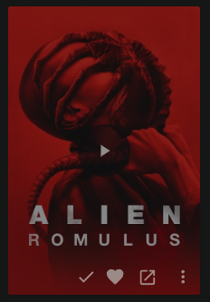

# BingeBase button for Jellyfin

A Jellyfin plugin that adds a **BingeBase** button to the web client, right next to the Played ✓ and Favorite ♥ buttons. One click opens the movie, show or person on [BingeBase](https://bingebase.com).

<p>
  
  &nbsp;
  
</p>

No Jellyfin or jellyfin-web files are modified, so server updates don't break or overwrite it.

## What it does

The button appears on:

| Where | Items |
|---|---|
| Item detail pages (next to ✓ ♥) | movies, shows, seasons, episodes, people |
| Card hover buttons in libraries, home rows and search | movies, shows, seasons, episodes, people |
| Cast & Crew row on a movie/show page | people |

Clicking opens a BingeBase search in a new tab, filtered to the right kind of item:

- **Movie:** `bingebase.com/search?query=Corpse%20Bride&filter=movies`
- **Show, season, episode:** the show's title, `filter=shows`
- **Person:** the person's name, `filter=people`

If a library title is localized (e.g. Cyrillic) and the item's original title is in Latin script, the original title is used instead, because BingeBase's catalog is in English (it uses TMDB data).

Music, books, photos, collections and other item types don't get a button.

## Requirements

- Jellyfin **12.x** server (built against 12.0, tested against the 12.2 web client).
- Clients that render the server's web interface: browsers, Jellyfin Media Player, and the Android mobile app. Native apps (Android TV, Swiftfin, Findroid, etc.) draw their own UI, so the button doesn't appear there.

## Install

### Option 1: plugin repository (recommended, any OS)

Works the same on Linux, Windows, macOS and Docker, and Jellyfin updates the plugin for you.

1. **Add the repository.** Go to **Dashboard → Plugins → Manage Repositories**, add a repository, and fill in:
   - **Repository Name:** `BingeBase`
   - **Repository URL:** `https://raw.githubusercontent.com/Whatevser/BingeBase-Link-Plugin-for-Jellyfin/main/manifest.json`
2. **Install the plugin.** Go back to **Plugins**, find **BingeBase** (category *General*) and install it.
3. **Restart Jellyfin** from **Dashboard → Restart**.
4. **Reload the web client** with a hard refresh (Ctrl+Shift+R).

### Option 2: manual zip

1. **Download.** Get `bingebase_<version>.zip` from [Releases](https://github.com/Whatevser/BingeBase-Link-Plugin-for-Jellyfin/releases).
2. **Extract** it into a new folder named `BingeBase_<version>` inside the server's `plugins` folder:

   | Host | Plugins folder |
   |---|---|
   | Linux (deb/rpm) | `/var/lib/jellyfin/plugins/` |
   | Windows (installer, service mode) | `C:\ProgramData\Jellyfin\Server\plugins\` |
   | Windows (tray / per-user install) | `%LOCALAPPDATA%\jellyfin\plugins\` |
   | Docker | `/config/plugins/` (inside the container) |

   On Linux, make the folder readable by the `jellyfin` user (`sudo chown -R jellyfin:jellyfin <folder>`).
3. **Restart Jellyfin** from **Dashboard → Restart**.
4. **Hard-refresh** the web client.

Older versions don't need to be removed. When several versions of the same plugin are present, Jellyfin loads the newest and marks the others as superseded.

## How it works, and why this way

The plugin has three small parts: a plugin class, an ASP.NET Core middleware, and one JavaScript file embedded in the DLL.

1. **Server: injecting the script.** The plugin registers an `IStartupFilter` through Jellyfin's `IPluginServiceRegistrator`. The filter puts a middleware in front of Jellyfin's request pipeline. When a browser requests `web/index.html`, the middleware lets Jellyfin serve the file as usual, then adds one `<script>` tag before `</body>` on the way out. Every other request passes straight through.
   - It strips `Accept-Encoding`, `If-None-Match`, `If-Modified-Since` and `Range` from that one request. That way it always rewrites the plain file, never a compressed body or an empty `304`.
   - It recomputes `Content-Length` and drops the `ETag` and `Last-Modified` headers.
2. **Client: adding the buttons.** The script watches the page with a `MutationObserver` and adds the button in two places:
   - **Detail pages:** after the Favorite button in `.mainDetailButtons`.
   - **Cards:** before the ⋮ button in each card's `.cardOverlayButton-br` group. This group is the same in jellyfin-web's legacy card builder and in its newer React cards.

   Cast and crew cards carry the person's role (`Actor`, `Director`, …) as their type, so they are recognised by their `personCard` class instead.
3. **On click: building the URL.** The script asks the server for the item (seasons and episodes are resolved to their show) and builds the search URL.
   - **Prefetching:** on cards, the lookup starts when the mouse moves over the button, so the URL is usually ready by the time you click.
   - **Popup blockers:** if the URL isn't ready yet, the new tab is opened immediately inside the click and pointed at BingeBase once the lookup returns, so popup blockers don't stop it.

### Why not something simpler

- **A link in the Links row.** Jellyfin's `IExternalUrlProvider` adds an entry next to IMDb/TMDB on the detail page. It needs no web-client code, and the first version of this plugin used it. It can't make a button, though, and it doesn't appear on cards at all.
- **Editing jellyfin-web.** Changes to `index.html` or the JS bundles on disk are overwritten by every Jellyfin update, and making them needs write access to the server's install folder.
- **Userscripts or a JS-injector plugin.** A userscript only works in one browser where it's installed. Injector plugins depend on another plugin that has to be updated for each Jellyfin release. Doing the injection inside this plugin keeps it self-contained, and it works in every client that uses the web interface.
- **Linking straight to the title page.** BingeBase title pages use slugs such as `/movies/corpse-bride-2005`. These can't be built reliably from library metadata: punctuation, remakes and same-year duplicates all break it. A filtered search gets you there in one click without ever landing on a 404.

## Troubleshooting

- **No button.** Hard-refresh the page (Ctrl+Shift+R). View the page source and search for `data-bingebase-plugin`. If it's missing, check **Dashboard → Plugins** to see whether BingeBase is *Active*.
- **Button shows, nothing happens.** Open the browser console (F12) and look for `[BingeBase]` errors.

## Building

GitHub Actions builds every push. Each run's zip is attached as an artifact under **Actions**.

To publish a release:

1. **Bump the version.** Raise `<Version>` in `Jellyfin.Plugin.BingeBase/Jellyfin.Plugin.BingeBase.csproj` and commit.
2. **Push a matching tag**, e.g. `git tag v2.3.0.0 && git push origin v2.3.0.0`.

The workflow then builds the zip, creates the GitHub release, and adds the version to `manifest.json`. Servers using the plugin repository pick it up automatically.

Local build (needs the .NET 10 SDK):

```bash
dotnet build Jellyfin.Plugin.BingeBase -c Release -o out
# out/Jellyfin.Plugin.BingeBase.dll is the plugin
```

`<JellyfinVersion>` in the `.csproj` sets which `Jellyfin.Controller` package it compiles against and the minimum server version (`targetAbi`). Keep it at the oldest 12.x release you want to support.

## Project layout

```
Jellyfin.Plugin.BingeBase/
  Plugin.cs          plugin entry + service registration
  WebInjection.cs    startup filter + index.html middleware
  Web/bingebase.js   the web-client script (embedded resource)
manifest.json        Jellyfin plugin repository manifest (updated by CI on release)
.github/workflows/   build, release and manifest automation
```
